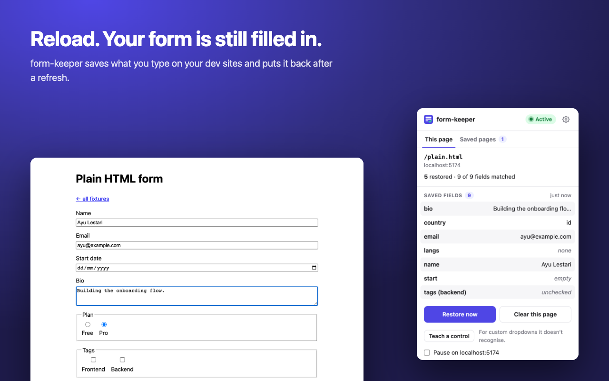
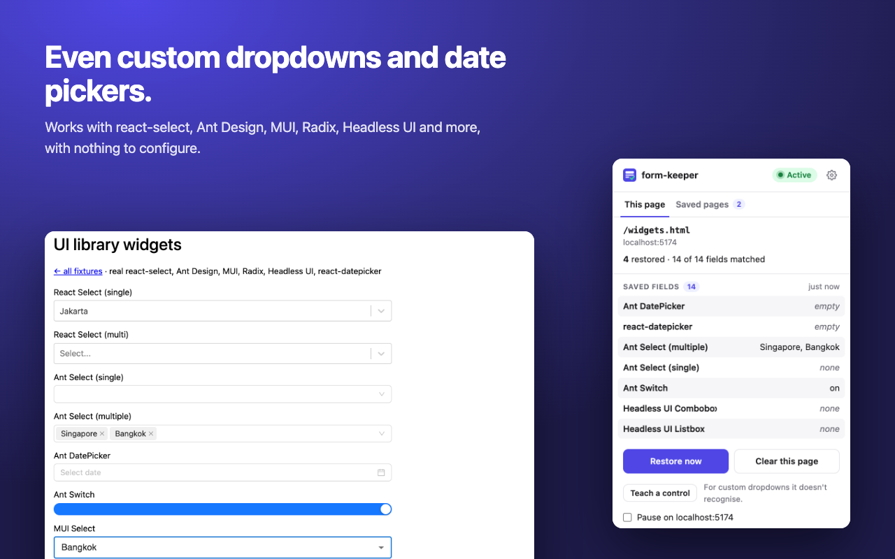
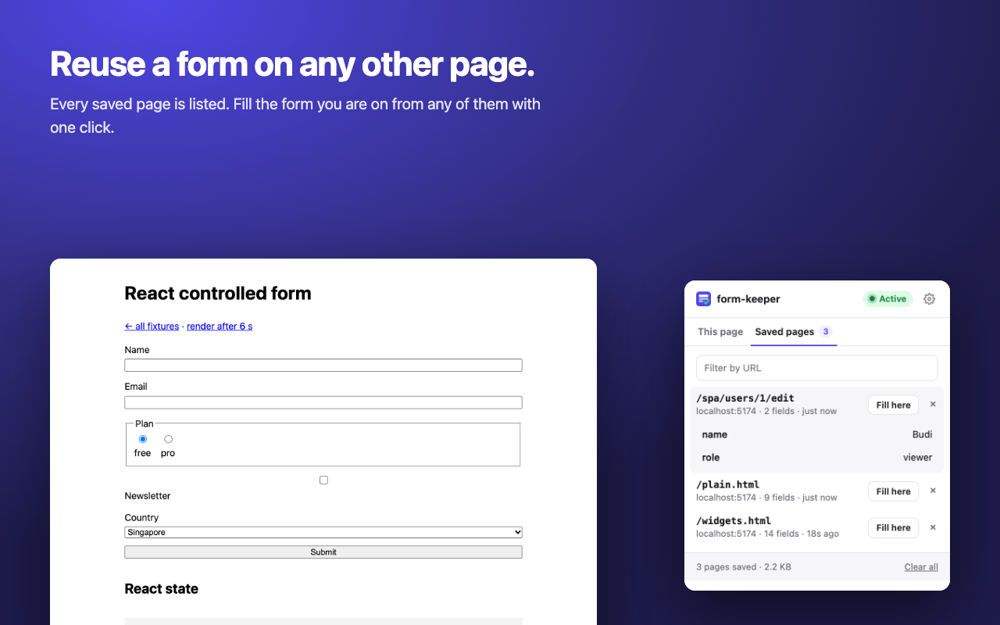
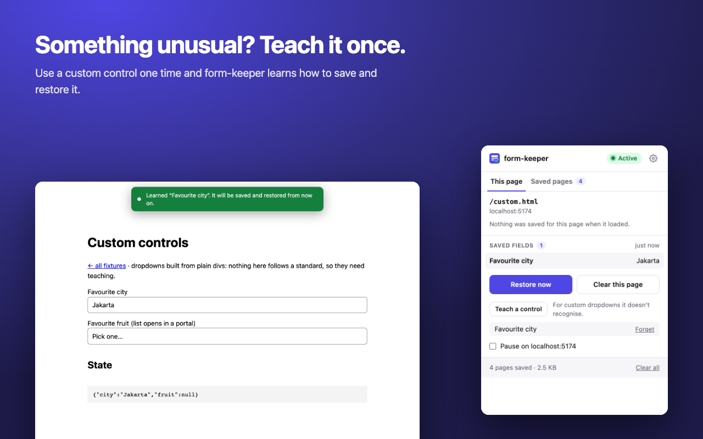
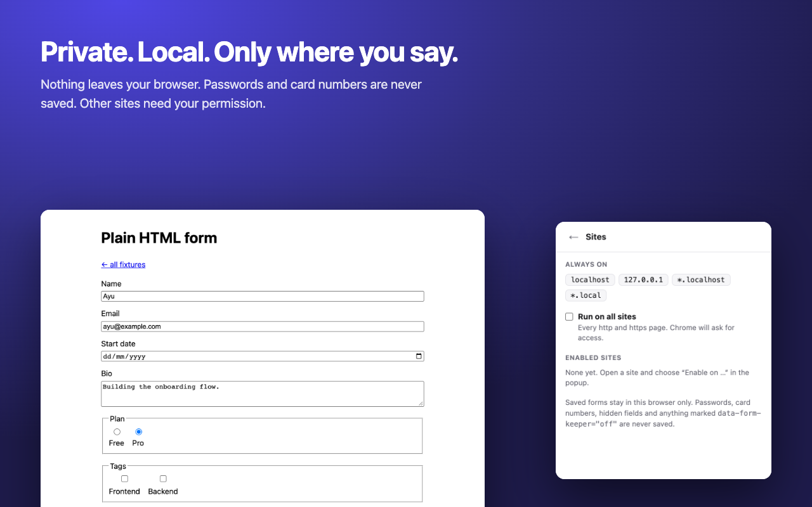

<p align="center">
  
</p>

<h1 align="center">form-keeper</h1>

<p align="center">
  <strong>Reload without losing your forms.</strong><br>
  A Chrome extension that saves what you type in a form and puts it back after a refresh,
  including in React, Vue and Svelte apps, and including custom dropdowns and date pickers.
</p>

<p align="center">
  <a href="https://heyhadi.github.io/form-keeper/">Website</a> ·
  <a href="INSTALL.md">Install</a> ·
  <a href="#how-it-works">How it works</a> ·
  <a href="#development">Development</a>
</p>



## Install

**Chrome Web Store:** coming soon. Until then it takes about a minute to install by hand, and
[INSTALL.md](INSTALL.md) walks through it step by step with no technical knowledge needed:

1. [Download the latest zip](https://github.com/heyhadi/form-keeper/releases/latest/download/form-keeper-chrome.zip) and unzip it.
2. Open `chrome://extensions` and turn on **Developer mode**.
3. Click **Load unpacked** and choose the unzipped folder.

Works in Chrome, Edge, Brave and other Chromium browsers.

## What it does

|  |  |
|---|---|
| **Saves as you type, restores on load.** Text, textareas, checkboxes, radios, selects. Forms that render late, and client-side routes, are covered. | **Works with your framework.** Restored values reach React, Vue and Svelte state, not just the screen. |
| **Dropdowns and date pickers too.** react-select, Ant Design, MUI, Radix, Headless UI, react-datepicker and anything that follows the standard patterns. | **Teach it anything else.** Use an unusual control once and form-keeper learns how to save and restore it. |



- **Runs on dev hosts out of the box** (`localhost`, `127.0.0.1`, `*.localhost`, `*.local`, any
  port). Any other site is opt-in from the popup: Chrome asks for access, and only then.
- **Shows whether it is running.** The toolbar icon is coloured with an **ON** badge (or the
  number of fields restored) where it is active, and grey everywhere else.
- **Popup with two tabs.** *This page* lists what is saved, with **Restore now**, **Clear this
  page** and **Pause on this site**. *Saved pages* lists every saved URL, with search, a peek at
  the fields, delete, and **Fill here** to copy one page's values into the form you are on.
- **Tells you what it could not restore,** and why.
- **Private.** Everything stays in `chrome.storage.local`. Nothing is sent anywhere. Passwords,
  hidden inputs (CSRF tokens), file inputs, `autocomplete="cc-*"` fields and anything inside
  `data-form-keeper="off"` are never saved. See the [privacy policy](docs/privacy.html).



### Teach mode



For a control that follows no standard, open the popup, press **Teach a control**, then use the
control once on the page. form-keeper records how to find it and what to click to open it, and
from then on matches options by their text alone, so it works with any markup. Taught controls
are listed in the popup and can be forgotten.

### Permissions

| Permission | Why |
|---|---|
| `storage` | Keep saved forms in your browser. |
| Content script on `localhost`, `127.0.0.1`, `*.localhost`, `*.local` | Read and fill form fields on development sites. |
| `activeTab` | Learn the address of the tab you open the popup on, to offer "Enable on this site". |
| `scripting` | Start on a site the moment you enable it, without a reload. |
| Optional: `http://*/*`, `https://*/*` | Only requested when you enable a site (or all sites) from the popup. |



## How it works

The core (`src/core`) is plain DOM code with no extension APIs, so it is unit-tested in jsdom.
The content script, background worker, storage layer and React popup are thin wrappers around it.

**Field keys.** Saved values are matched back to fields by a key built from markup only:
`<form scope> <field identity>`, for example `form#signup name=email`. The scope is the form's
`id`, then `name`, then its index on the page (`page` if there is no form). The identity is the
field's `name`, then its `id` (unless a library generated it), then its visible label, then its
tag path. `name` wins because it is what the server receives, so apps keep it stable.

**Restoring into frameworks.** React keeps its own copy of each controlled input's value. Writing
`el.value = x` updates that copy as well, so React treats the following `input` event as a
no-op and re-renders the old state. form-keeper calls the native `value` setter from the
element's prototype instead, then fires `input` and `change`. Checkboxes and radios are toggled
with a real `click()`, because React drives their `onChange` from `click`. A test in
`tests/react.test.tsx` shows the naive approach failing.

**No save loop.** Restoring fires the same events as typing. The keeper ignores events raised
during its own restore, and skips writes whose content matches what is already stored.

**Late and conditional fields.** A MutationObserver watches for added fields, added `<option>`s
and `disabled`/`readonly` changes, and retries only the fields still pending. It stops after 10
seconds, or as soon as you start typing, so it never overwrites your input. Fields that are not
on screen (another wizard step, a collapsed section) stay in storage instead of being dropped.

**Single-page apps.** The current URL is checked on every edit and DOM change (plus `popstate`
and the Navigation API). Fields are serialized when you type, not when the debounced write
fires; otherwise a quick navigation would save the next route's form under the previous URL.

**Custom controls.** These are not form fields, so there is nothing to read a value from.
Instead of one adapter per library, form-keeper works in layers and a control uses the first one
that fits:

1. *Taught controls*, which always win over a guess.
2. *Standards*: ARIA `combobox`/`listbox`/`option`, `role="switch"`/`checkbox`/`radiogroup`,
   segmented date fields (`role="spinbutton"` parts) and `contenteditable` rich text.
3. *Plain interaction*: the value saved is what the user sees (the option's label), restored the
   way a person would: open it, find the option, click it. Clicks are tried as pointer events,
   then as a keyboard Enter, because some libraries (Radix, for one) only react to the latter.

A field's identity must not depend on its current value. Ant Design inserts a live region with
the chosen option next to the control, and MUI points `aria-labelledby` back at the value; both
would change the key after a choice. Names are taken from the visible label and anything that
echoes the value is ignored. A widget that still shows its first reading ("Choose…", "None") is
treated as empty.

**Filling from another page.** Values are re-keyed to the current page: exact key matches
first, then the first unclaimed field with the same name and kind, in DOM order. This looser
matching is only used when you ask for it, so automatic restore can never put a value into the
wrong form.

**Other sites.** Host access is an optional permission requested per site from a click in the
popup. The background worker registers the content script for the granted sites at runtime with
`chrome.scripting`, and the popup injects it into the open tab so it starts without a reload.
Revoking access in Chrome's own settings removes the site here too.

**Debugging a widget.** Set `localStorage['form-keeper:debug'] = '1'` on the page and the console
logs what every widget attempt does.

## Development

```sh
npm install
npm run dev          # opens Chrome with the extension loaded and hot-reloading
npm run fixtures     # test pages at http://localhost:5174: plain HTML, React, Vue, Svelte,
                     # SPA, real UI libraries, and deliberately non-standard controls
npm test             # unit tests (Vitest + jsdom)
npm run e2e          # builds a test copy and drives real Chromium with it loaded (Playwright)
npm run typecheck
npm run zip          # production package for the Chrome Web Store / GitHub release
```

- The e2e build goes to `.output-e2e` with all hosts pre-granted, because Playwright can't click
  Chrome's permission prompt. Don't load that copy for daily use.
- The end-to-end tests open a fresh tab rather than reloading, so Chrome's own form restoration
  can't make a test pass by accident.
- `node scripts/generate-icons.mjs` redraws the toolbar icons; `node scripts/store-assets.mjs`
  regenerates the store screenshots from the real extension (after `FK_E2E=1 npx wxt build`).
- Store listing text, permission justifications and the publishing checklist are in
  [store/LISTING.md](store/LISTING.md).

## Roadmap

1. ~~Save and restore native fields~~
2. ~~Late-rendered forms, Vue/Svelte, SPA routes, active indicator, popup, custom controls~~
3. File and image inputs, rebuilt with `DataTransfer`
4. Snapshot history: working draft, snapshots, dedupe, retention, pinning
5. Side panel UI: browse, search, preview, restore
6. URL pattern grouping (`/users/:id/edit`)
7. Chrome Web Store listing

## Known limits

- Fields inside shadow DOM and iframes are not captured.
- File inputs and drag-and-drop uploaders come in milestone 3.
- Search boxes that load options from a server only restore if the option appears after the saved
  text is typed.
- Teach mode handles dropdown-style controls; calendars and other multi-step pickers are not
  supported yet.

## License

[MIT](LICENSE) © Munawirul Hadi
